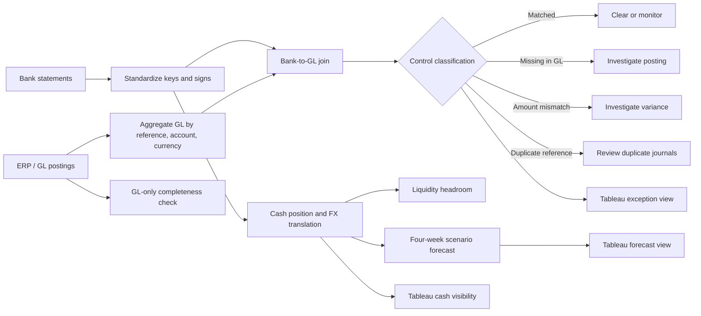

# TechGiant Global Treasury Cash Visibility

Independent, synthetic treasury transformation case study for a **Treasury Management System (TMS) Implementation / Finance Solutions** portfolio.

The project demonstrates how a treasury team can combine cash visibility, bank-to-book reconciliation, liquidity forecasting, exception management, and TMS integration research into a controlled workflow. TechGiant Inc., its banks, transactions, FX rates, and account data are fictional.

## What this project demonstrates

- Consolidated cash visibility across **5 bank accounts**, **4 currencies**, and **3 legal entities**.
- USD reporting using documented, illustrative FX assumptions.
- Bank-to-GL reconciliation using a composite key: transaction reference, account, and currency.
- Control detection for missing GL postings, amount mismatches, duplicate GL references, and GL-only postings.
- Four-week scenario-based liquidity forecasting.
- Tableau-ready extracts for cash position, daily cash movement, exceptions, and forecast.
- A proposed Alteryx workflow and a Kyriba Developer Portal research log.

## Headline results

| Metric | Result |
|---|---:|
| Bank transactions | 20 |
| GL rows | 21 |
| Matched bank transactions | 17 |
| Bank-side exceptions | 3 |
| GL-only postings | 1 |
| Consolidated closing cash | USD 3,776,601.50 |
| Liquidity headroom above reserves | USD 3,150,851.50 |

The cash position is calculated from opening balances plus bank-statement movements. It is intentionally **not adjusted for unresolved reconciliation exceptions**; exception counts are shown separately so the control risk is visible.

## Repository map

| Location | Purpose |
|---|---|
| `TechGiant_Global_Cash_Visibility_Project.xlsx` | Main Excel model, control tests, cash position, and forecast |
| `data/` | Synthetic source data and expected reconciliation outputs |
| `tableau/` | Tableau-ready extracts and legacy-artifact status |
| `documentation/` | Build guides, interview notes, API research log, and resume wording |
| `docs/workflow.md` | End-to-end process flowchart and implementation narrative |
| `scripts/validate_project.py` | Dependency-free structural and control validation |
| `docs/implementation-status.md` | Honest status of Excel, Python, Alteryx, Tableau, and Kyriba work |
| `evidence/` | Reserved for screenshots of locally completed Alteryx/Tableau work |
| `outputs/` | Reserved for generated Alteryx outputs |

## End-to-end workflow



See [`docs/workflow.md`](docs/workflow.md) for the detailed flow, controls, and implementation decisions.

The correction and evidence checklist is in [`docs/audit-checklist.md`](docs/audit-checklist.md). Implementation boundaries are documented in [`docs/implementation-status.md`](docs/implementation-status.md) and [`docs/assumptions-and-controls.md`](docs/assumptions-and-controls.md).

## Quick start

From this project folder:

```bash
python scripts/validate_project.py
```

The validator uses only the Python standard library. It checks that the expected CSVs exist, row counts are consistent, the known control exceptions are present, the portfolio metrics reconcile, and the repository contains no obvious secret-file patterns.

For the full case-study walkthrough, start with [`START_HERE.md`](START_HERE.md), then open the Excel workbook. The Alteryx and Tableau guides document the exact build steps for recreating the workflow in those tools. Tableau currently has validated CSV extracts and preview images, not a verified native workbook.

## Scope and integrity statement

This is a simulated learning project. It is not a live TechGiant engagement, bank connection, Kyriba implementation, SAP integration, or production payment process. Kyriba is referenced for product and API context only; the project does not claim live API execution. Any future API work must be performed in an authorised sandbox and documented separately without publishing credentials or tokens.

Only claim Alteryx workflow execution or Tableau dashboard completion after personally running and saving those artifacts in the relevant software. No native `.yxmd` or verified `.twb/.twbx` is claimed in this repository. Screenshots in `evidence/` should be treated as supplied reference material unless they represent work you have personally completed.

## Portfolio positioning

**Suggested resume title:**  
**Global Treasury Cash Visibility & Reconciliation | Excel, Alteryx, Tableau | Independent Simulated Case Study**

Use the role-specific wording in [`documentation/Resume_Wording_After_Completion.md`](documentation/Resume_Wording_After_Completion.md), selecting only the bullets that match the work you have genuinely completed.
