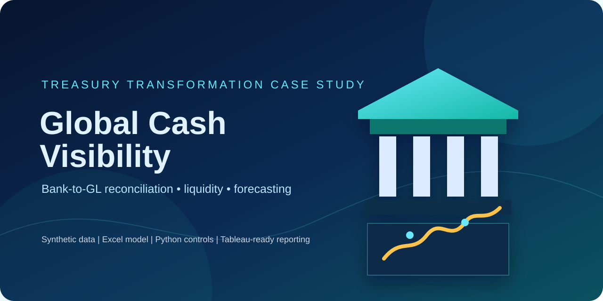
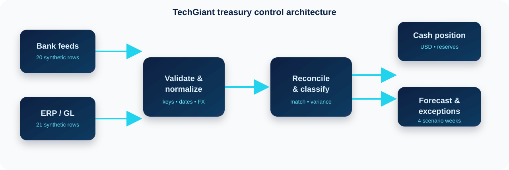
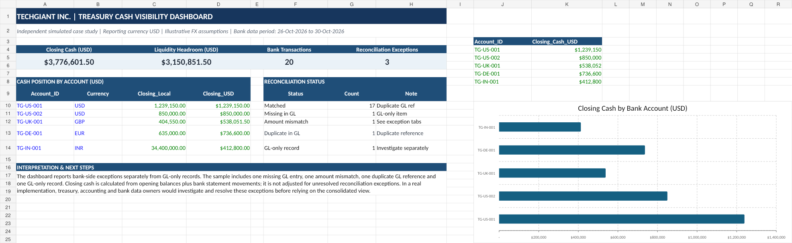
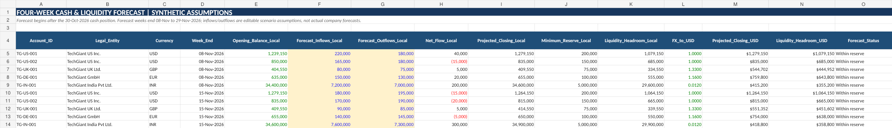

<p align="center">
  
</p>

<h1 align="center">TechGiant Global Treasury Cash Visibility</h1>

<p align="center">
  <strong>Bank-to-GL reconciliation, liquidity analysis, and four-week cash forecasting</strong><br>
  Independent synthetic case study for Treasury Management System implementation and Finance Transformation roles.
</p>

<p align="center">
  
  
  
  
  
</p>

> **Portfolio scope:** This is a fictional, synthetic treasury case study. It demonstrates the analysis and control design expected in a treasury transformation project; it is not a live TechGiant engagement, bank connection, SAP integration, Kyriba implementation, or production payment process.

## Executive summary

TechGiant Inc. is modelled as a multinational group with five bank accounts across four currencies and four legal entities. The project creates a consolidated USD cash view, reconciles bank statement movements to ERP/GL postings, isolates accounting exceptions, and prepares an illustrative four-week liquidity scenario.

The model keeps two management questions separate:

1. **How much cash is visible?** Opening balances plus bank-statement movements, translated into USD.
2. **Can the cash be trusted?** Bank-to-GL controls, duplicate detection, missing postings, variances, and GL-only items.

This separation prevents a clean-looking cash total from being mistaken for proof that bank-to-book controls are complete.

## Key KPIs

<table>
  <tr>
    <td align="center"><strong>5</strong><br>bank accounts</td>
    <td align="center"><strong>4</strong><br>legal entities</td>
    <td align="center"><strong>USD 3.78M</strong><br>closing cash</td>
    <td align="center"><strong>USD 3.15M</strong><br>liquidity headroom</td>
  </tr>
</table>

| Control metric | Result |
|---|---:|
| Currencies | 4: USD, GBP, EUR, INR |
| Bank transaction rows | 20 |
| GL journal rows | 21 |
| Matched bank references | 17 |
| Amount mismatches | 1 |
| Missing GL postings | 1 |
| Duplicate GL references | 1 |
| GL-only journal records | 1 |
| Minimum reserves translated to USD | USD 625,750.00 |

## Business problem

Global treasury teams often receive cash data from multiple banks while accounting teams maintain separate ERP/GL records. Without a repeatable control process, the organization may not know whether:

- a bank fee was posted to the GL;
- a payment was posted at the correct amount;
- one bank reference was used for multiple journals;
- a GL entry has no corresponding bank movement; or
- cash above reserve is available and supported by reliable records.

## Solution architecture

<p align="center">
  
</p>

| Layer | Case-study implementation |
|---|---|
| Inputs | Synthetic bank transactions, GL postings, account master, FX assumptions |
| Validation | Python standard-library validator with source-derived calculations |
| Financial model | Excel workbook with linked formulas, control tests, cash position, and forecast |
| Reconciliation | Composite matching on reference, account, and currency |
| Reporting | Tableau-ready CSV extracts and supplied reference previews |
| Planned transformation path | Alteryx workflow guide and Kyriba/TMS integration research |

## Reconciliation methodology

The bank-to-GL matching key is deliberately composite:

```text
Bank_Ref = GL_Ref
Account_ID matches
Currency matches
```

For each bank row:

```text
GL total       = sum(matching GL cash impacts)
GL match count = count(matching GL rows)
Variance       = bank cash impact - GL total
```

Classification priority:

1. More than one GL match → **Duplicate in GL**
2. No GL match → **Missing in GL**
3. One match with variance above 0.01 → **Amount mismatch**
4. Otherwise → **Matched**

The reverse completeness check identifies GL rows with no corresponding bank-side record.

## Exception analysis

| Reference | Finding | Business interpretation |
|---|---|---|
| `BT003` | Bank payment USD 90,000 vs GL USD 89,500; variance USD -500 | Review posting accuracy, payment support, bank charges, and sub-ledger allocation |
| `BT004` | USD 850 bank service fee has no GL posting | Investigate the fee and its appropriate accounting entry |
| `BT014` | EUR 120,000 bank reference linked to two GL rows totalling EUR 240,000 | Investigate both journals; this is a duplicate reference, not proof of duplicate payment |
| `GL999` | USD -42,000 GL-only record | Investigate timing, supporting documentation, and expected bank movement |

## Cash visibility and liquidity

```text
Closing cash (local) = opening balance + bank-statement movement
Closing cash (USD)   = closing cash (local) × illustrative FX rate
Headroom             = closing cash - minimum reserve
```

Closing cash is **not adjusted for unresolved reconciliation exceptions**. The exceptions remain visible as a separate control view.

## Four-week scenario forecast

The forecast starts from the 30-Oct-2026 cash position. It is an illustrative scenario, not an actual company forecast or historically validated forecasting model.

| Week ending | Projected closing cash | Projected headroom |
|---|---:|---:|
| 08-Nov-2026 | USD 3,833,851.50 | USD 3,208,101.50 |
| 15-Nov-2026 | USD 3,803,301.50 | USD 3,177,551.50 |
| 22-Nov-2026 | USD 3,885,551.50 | USD 3,259,801.50 |
| 29-Nov-2026 | USD 3,867,451.50 | USD 3,241,701.50 |

## Reporting previews

The repository includes supplied reference previews for the Excel model and forecast. They are labelled as reference evidence; no Tableau screenshot is presented as a completed native Tableau dashboard.

| Excel cash visibility preview | Excel forecast preview |
|---|---|
|  |  |

## Tools and implementation status

| Capability | Status |
|---|---|
| Excel cash model and linked control formulas | Included |
| Python source-derived validation | Included and tested |
| Tableau-ready extracts | Included and validated |
| Native Tableau workbook | Not verified; legacy XML artifact quarantined |
| Native Alteryx `.yxmd` workflow | Not included; build guide provided |
| Kyriba API research | Documentation/design research only |
| SAP, bank connectivity, SWIFT, live TMS, or production payments | Not implemented |

See [`docs/implementation-status.md`](docs/implementation-status.md) for the evidence boundary.

## Repository navigation

| Path | Contents |
|---|---|
| [`START_HERE.md`](START_HERE.md) | Guided walkthrough |
| [`TechGiant_Global_Cash_Visibility_Project.xlsx`](TechGiant_Global_Cash_Visibility_Project.xlsx) | Excel model and control-test workbook |
| [`data/`](data/) | Source and derived CSVs with data dictionary |
| [`scripts/validate_project.py`](scripts/validate_project.py) | Source-derived validation entry point |
| [`tests/`](tests/) | Automated regression tests |
| [`tableau/`](tableau/) | Validated Tableau-ready extracts and status guide |
| [`docs/`](docs/) | Architecture, assumptions, status, audit, and metadata guides |
| [`documentation/`](documentation/) | Detailed Alteryx, Tableau, Kyriba, interview, and resume notes |
| [`evidence/`](evidence/) | Supplied reference PDFs and evidence notes |
| [`docs/images/`](docs/images/) | Original local SVG visual assets |

## Setup and execution

From the repository root:

```bash
python scripts/validate_project.py
python -m unittest discover -s tests -v
```

The project uses the Python standard library for validation and tests. No API keys, credentials, private connection strings, or client data are required.

## Controls and quality assurance

- Required files and columns are checked.
- Numeric fields and mappings are validated.
- Bank and GL identifiers are checked for duplicates.
- Reconciliation outputs are recalculated from source CSVs.
- Cash, reserve, headroom, forecast, and Tableau extracts are cross-checked.
- Excel formula presence is inspected in the workbook package.
- Credential-like filenames are rejected.
- A GitHub Actions workflow runs the validator and tests on pushes and pull requests.

See [`docs/audit-checklist.md`](docs/audit-checklist.md) for the completed correction audit.

## Business value

The case study demonstrates a practical finance-transformation mindset: define the control objective, normalize source data, establish deterministic matching rules, quantify exceptions, separate cash visibility from data-quality confidence, and document the path from prototype analysis to a future TMS operating model.

## Limitations and future enhancements

- Build and execute a genuine Alteryx workflow, then add the `.yxmd` and run evidence.
- Build and reopen a native Tableau workbook, then add the verified `.twb/.twbx`.
- Add a sanctioned API sandbox integration only with documented authorization and sanitized evidence.
- Add exception ageing, ownership, remediation status, and approval workflow.
- Add real forecast accuracy evaluation only when historical actuals exist.

## Synthetic-data declaration

All company names, banks, account identifiers, counterparties, balances, transactions, FX rates, and forecast assumptions are fictional and created for portfolio demonstration.
