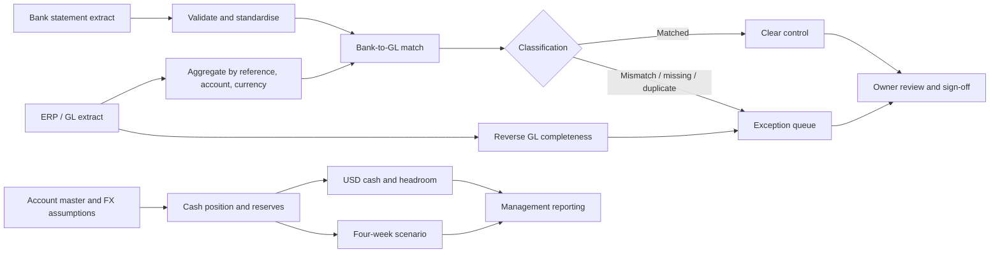

# As-is and proposed to-be process

This is a design simulation. The as-is description is inferred from the case-study problem, not from a real client process.

## Current-state view

- Bank statements and GL extracts are available as separate files.
- Field names, reference formats and record counts need to be checked before matching.
- Reconciliation exceptions are identified after data preparation.
- Cash visibility and reconciliation confidence are separate questions.
- Follow-up ownership and production sign-off are outside this repository.

## Proposed future-state view

## Proposed hand-offs

| Stage | Handoff | Control point |
|---|---|---|
| Ingestion | Bank and GL files to data preparation | File name, date, schema and row-count checks |
| Preparation | Standardised streams to matching | Composite keys are nonblank and type-compatible |
| Reconciliation | Match output to exception owner | Status, variance and evidence reference are retained |
| Cash position | Account data to treasury reporting | Opening balance, movement, FX and reserve totals tie out |
| Follow-up | Exception queue to finance owner | Resolution, reviewer and date would be recorded in a live process |

