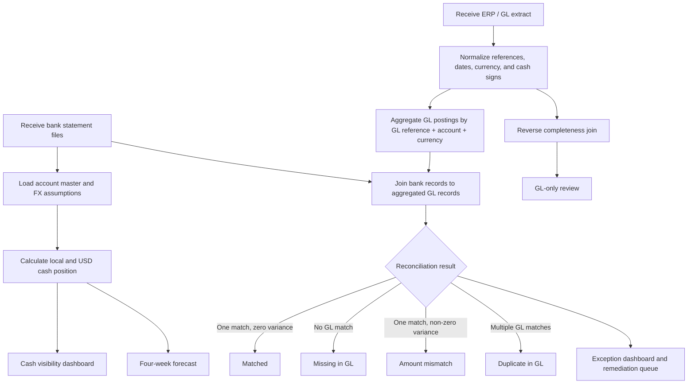

# Treasury workflow and implementation narrative

## Business objective

The case study addresses a common treasury-control problem: cash is distributed across bank accounts and currencies, while accounting records can contain missing, duplicated, or incorrectly valued postings. The workflow creates one controlled path from raw bank and GL data to management reporting and exception remediation.

## Process flow



## Control logic

The bank-side matching key is intentionally composite:

1. `Bank_Ref = GL_Ref`
2. `Account_ID` matches
3. `Currency` matches

For each bank transaction:

```text
GL_Cash_Impact_Local = sum(matching GL rows)
GL_Match_Count = count(matching GL rows)
Variance_Local = Bank_Cash_Impact_Local - GL_Cash_Impact_Local
```

Classification priority:

1. `GL_Match_Count > 1` → **Duplicate in GL**
2. `GL_Match_Count = 0` → **Missing in GL**
3. `abs(Variance_Local) > 0.01` → **Amount mismatch**
4. Otherwise → **Matched**

The reverse join identifies GL postings that have no corresponding bank reference and labels them **GL-only: investigate**.

## Exception register

| Reference | Exception | Expected investigation |
|---|---|---|
| `BT003` | Bank payment is USD 90,000; GL is USD 89,500; variance is USD 500 | Review payment support, bank charges, and posting correction |
| `BT004` | USD 850 bank fee has no GL match | Confirm the fee and post or explain the missing journal |
| `BT014` | Two GL rows share one EUR bank reference | Determine whether one journal is duplicate or both are valid allocations |
| `GL999` | GL-only posting has no bank reference | Confirm whether it is pending bank activity, a timing item, or an erroneous journal |

## Cash and liquidity model

For each account:

```text
Net bank movement = sum(bank cash impact in local currency)
Closing cash = opening balance + net bank movement
Closing cash (USD) = closing cash × illustrative USD FX rate
Liquidity headroom = closing cash - minimum reserve
```

The model deliberately keeps cash visibility and reconciliation exceptions as separate management views. This avoids presenting a clean-looking cash total as proof that the underlying bank-to-book controls are complete.

## TMS implementation framing

In a production implementation, the process would normally be extended with:

- Bank connectivity and statement ingestion.
- Mapping rules for bank formats, entities, accounts, currencies, and value dates.
- ERP/GL integration and posting-status controls.
- Exception ownership, ageing, escalation, and evidence retention.
- Role-based access, approval controls, audit logs, and environment promotion.
- Reconciliation cut-off, rerun, and sign-off procedures.
- API monitoring and secure credential management.

The supplied project documents the target operating model without claiming that a live TMS, bank connection, SAP interface, or Kyriba API was configured.
